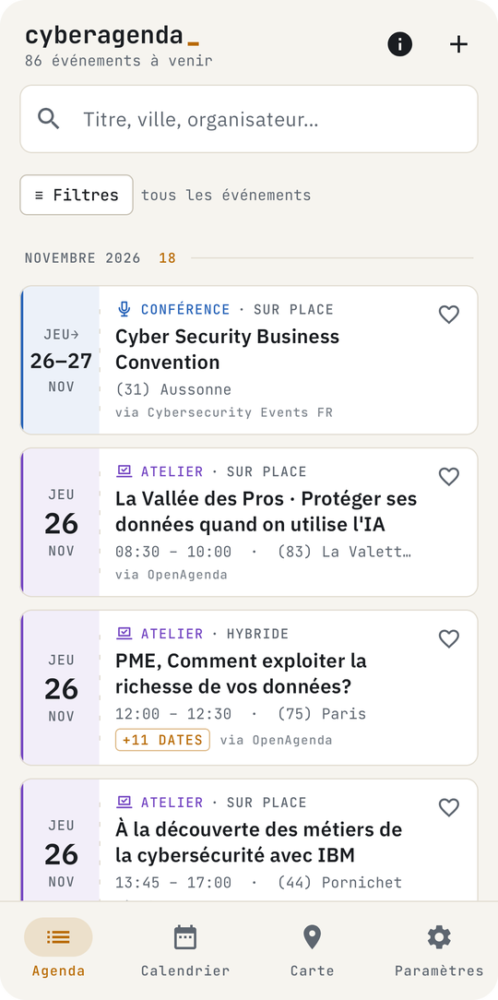
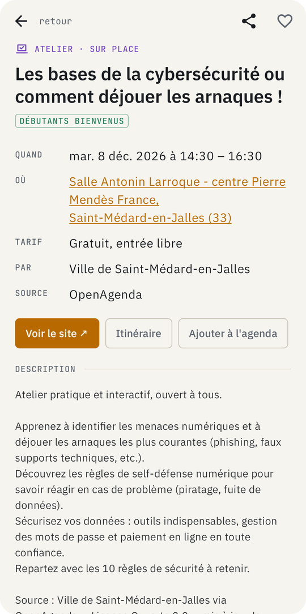
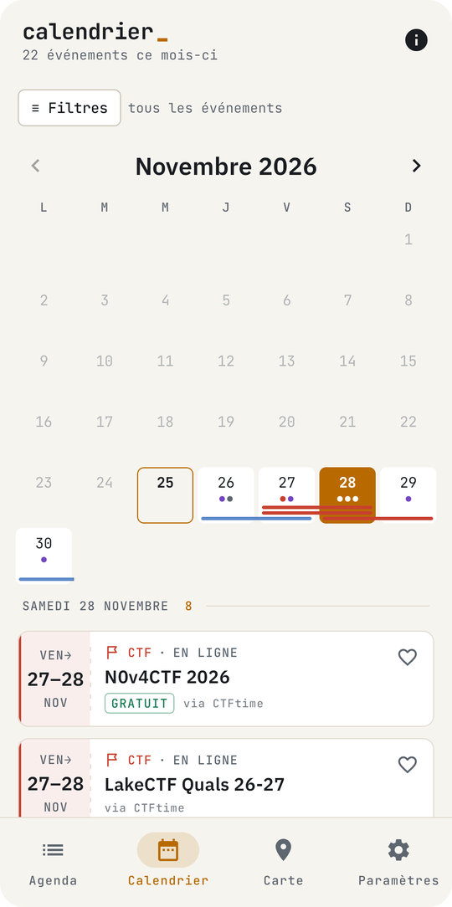
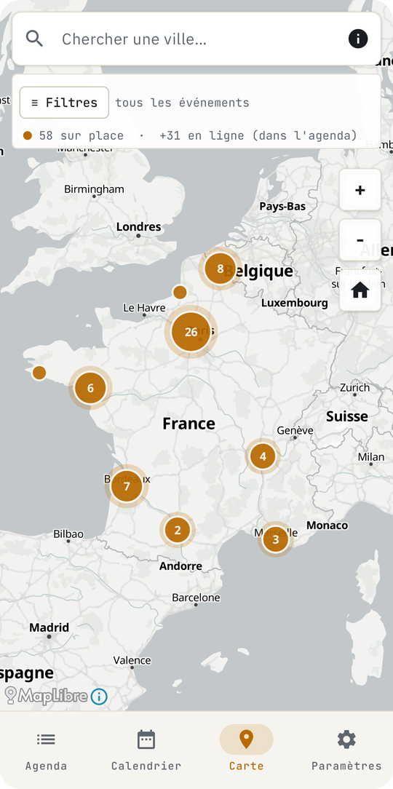
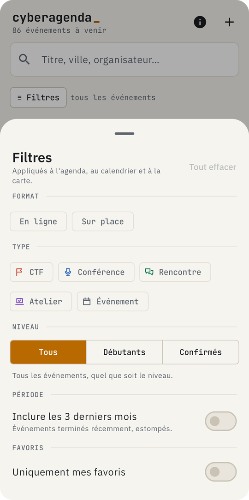

<h1 align="center">cyberagenda_</h1>

<p align="center">
  <b>Tous les événements cyber en France, dans une seule app.</b><br>
  CTF, conférences, ateliers et rencontres : de quoi débuter, apprendre et rencontrer du monde.
</p>

<p align="center">
  <a href="../../releases/latest"></a>
</p>

<p align="center">
  
  
  
  
</p>

---

## Pourquoi CyberAgenda ?

Les événements cyber sont éparpillés entre CTFtime, des agendas associatifs, des listes sur GitHub
et des sites d'organisateurs. Quand on débute, on ne sait ni où chercher ni par où commencer.

**CyberAgenda rassemble tout au même endroit**, signale ce qui est **ouvert aux débutants**, et
explique le vocabulaire (CTF, flag, writeup…). Pas d'inscription, pas de publicité : on ouvre l'app
et on trouve son prochain événement.

## Ce qu'elle fait

<table>
  <tr>
    <td width="38%" align="center"></td>
    <td width="62%" valign="middle">
      <h3>📋 Un agenda clair</h3>
      Les événements à venir, groupés par mois : type, format (en ligne ou sur place), dates et ville
      avec son département. Les CTF en ligne de la semaine sont regroupés pour ne pas noyer le reste,
      et la recherche trouve un titre, une ville ou un organisateur.
    </td>
  </tr>
  <tr>
    <td width="62%" valign="middle">
      <h3>🌱 Pensée pour débuter</h3>
      Les ateliers « débutants bienvenus » sont repérés d'un coup d'œil. Chaque fiche donne l'adresse,
      le tarif quand il est connu, et permet d'ajouter l'événement à votre agenda (Google, Proton,
      Outlook…), d'obtenir l'itinéraire ou de le partager. Une visite guidée et un lexique
      (CTF, flag, writeup…) accompagnent les premiers pas.
    </td>
    <td width="38%" align="center"></td>
  </tr>
  <tr>
    <td width="38%" align="center"></td>
    <td width="62%" valign="middle">
      <h3>🗓️ Le mois en un coup d'œil</h3>
      Des points pour les événements d'une journée, des barres pour ceux qui durent plusieurs jours.
      Touchez un jour pour voir son programme, balayez pour changer de mois, ou touchez le mois
      pour sauter directement à une date.
    </td>
  </tr>
  <tr>
    <td width="62%" valign="middle">
      <h3>🗺️ Près de chez vous</h3>
      Cherchez une ville, choisissez un rayon de 10 à 100 km et voyez ce qui se passe autour.
      Les événements proches se regroupent en bulles numérotées qui se séparent en zoomant.
      La recherche se fait hors ligne : aucune position n'est demandée ni envoyée.
    </td>
    <td width="38%" align="center"></td>
  </tr>
  <tr>
    <td width="38%" align="center"></td>
    <td width="62%" valign="middle">
      <h3>🎯 Juste ce qui vous intéresse</h3>
      Format, type d'événement, niveau débutant ou confirmé, favoris : le filtre s'applique à l'agenda,
      au calendrier et à la carte, et il est conservé. Mettez un événement en favori pour recevoir un
      rappel la veille ou une heure avant.
    </td>
  </tr>
</table>

## D'où viennent les événements ?

| Source | Ce qu'elle apporte |
|---|---|
| Sélection CyberAgenda | Événements vérifiés à la main, signés numériquement *(bientôt)* |
| [CTFtime](https://ctftime.org) | Les CTF en ligne du monde entier et les CTF sur place en France |
| [Cybersecurity Events FR](https://github.com/alexandredubois/cybersecurity-events) | Salons et conférences cyber en France |
| [Agenda du Libre](https://www.agendadulibre.org) | Ateliers et cafés « vie privée », chiffrement, sécurité au quotidien |
| [OpenAgenda](https://openagenda.com) | Ateliers, webinaires et conférences d'associations, médiathèques, CCI et réseaux du numérique |
| [confs.tech](https://confs.tech/security) | Conférences sécurité, en ligne ou en France |

Un même événement publié par plusieurs sources n'apparaît qu'une fois. Chaque source peut être
désactivée dans les paramètres. Il manque un événement ? Proposez-le directement depuis l'app (bouton **+**).

## Respect de la vie privée

- **Aucun compte, aucune publicité, aucun traqueur**, aucune mesure d'audience.
- Favoris et réglages **restent sur le téléphone** et sont exclus des sauvegardes.
- **Aucune permission de localisation** : la recherche de ville se fait hors ligne.
- L'app ne contacte que les sources d'événements et le fond de carte
  ([OpenFreeMap](https://openfreemap.org)). Le détail est dans l'écran *Confidentialité* de l'app.

## Sécurité

Une app sur la cybersécurité se doit d'être exemplaire. CyberAgenda suit l'[OWASP MASVS](https://mas.owasp.org/MASVS/)
et a fait l'objet d'un audit (tests statiques et dynamiques) dont les points importants ont été corrigés :

- connexions **HTTPS uniquement**, avec **épinglage des certificats** de chaque source ;
- toutes les données reçues sont **revérifiées et nettoyées** : liens https uniquement, texte brut,
  aucun contenu web exécuté, adresse du site affichée avant de l'ouvrir ;
- la sélection CyberAgenda est **signée (Ed25519)** : une version modifiée est refusée ;
- une seule activité exposée aux autres applications, aucune permission sensible.

Vous avez trouvé une faille ? Merci de la signaler de façon responsable via un
[signalement privé](../../security/advisories/new) plutôt qu'une issue publique.

## Installer

> [!NOTE]
> CyberAgenda arrive très prochainement sur le Play Store. En attendant, cette **version de test**
> s'installe à partir de l'APK ; elle peut contenir des bugs.

1. Téléchargez l'APK depuis la [dernière version](../../releases/latest) :
   `CyberAgenda-<version>-arm64-v8a.apk` convient à presque tous les téléphones récents.
   En cas de doute, prenez la version `universal` (plus lourde, mais compatible partout).
2. Ouvrez le fichier sur votre téléphone. Android demande d'autoriser l'installation
   d'applications inconnues pour votre navigateur ou votre gestionnaire de fichiers : acceptez
   pour cette fois, puis désactivez l'autorisation après l'installation.
3. Ouvrez CyberAgenda : la visite guidée vous montre où se trouve chaque chose.

<details>
<summary><b>Vérifier que l'APK est authentique</b></summary>

Chaque version publie les sommes SHA-256 des fichiers. Le certificat de signature de l'application est :

```
SHA-256 : e9:ff:51:99:b4:21:c5:e6:64:0c:bb:65:58:b1:32:1b:f4:b2:60:52:59:b6:92:94:28:c2:76:39:bf:ad:f9:99
```

Vérification avec les outils Android : `apksigner verify --print-certs CyberAgenda-*.apk`, ou sur le
téléphone avec l'app [AppVerifier](https://github.com/soupslurpr/AppVerifier).
Les mises à jour s'installent par-dessus la version précédente (favoris conservés) tant qu'elles
sont signées avec ce même certificat.
</details>

**Configuration requise :** Android 8.0 ou plus récent, une connexion Internet pour actualiser les événements.

## Contribuer

- **Proposer un événement** : bouton **+** dans l'app, ou une [issue](../../issues/new).
- **Signaler un bug ou suggérer une idée** : [issues](../../issues).
- **Développer** : architecture, ajout d'une source, sécurité et commandes de build sont décrits
  dans [docs/DEVELOPPEMENT.md](docs/DEVELOPPEMENT.md).

## Confidentialité

Aucun compte, aucune publicité, aucun traceur : voir la [politique de confidentialité](PRIVACY.md).

## Licence

© 2026 Kalypt — code publié sous [licence MIT](LICENSE) : réutilisation, modification et
redistribution libres, **à condition de conserver la mention de copyright et la licence**
(citer l'auteur).

Les données affichées restent sous la licence de leur source : CTFtime, Agenda du Libre,
Cybersecurity Events FR (GPL-3.0), confs.tech (MIT), OpenAgenda (licence de chaque organisateur, le plus
souvent Licence Ouverte 2.0), fond de carte OpenFreeMap / © contributeurs
OpenStreetMap (ODbL), communes geo.api.gouv.fr (Licence Ouverte 2.0). Polices IBM Plex Sans,
JetBrains Mono, Caveat, Playfair Display et Press Start 2P sous SIL Open Font License 1.1.
